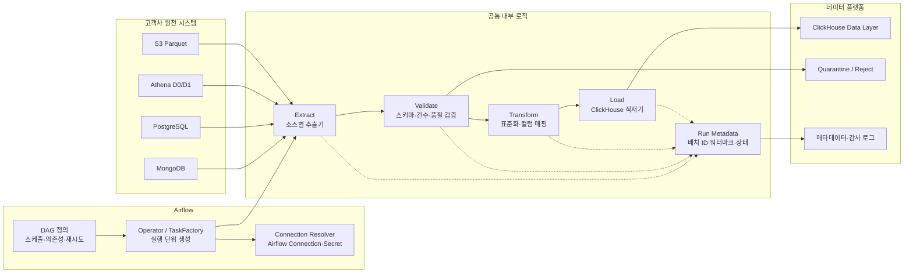

# Data Platform Airflow 소스 아키텍처

## 1. 목표

고객사별 MongoDB, PostgreSQL, Athena, S3 원천 데이터를 수집하고, 공통 검증·표준화 로직을 거쳐 ClickHouse Data Layer에 적재한다. Airflow DAG는 스케줄링과 실행 흐름을 담당하고, 데이터 처리 로직은 별도의 내부 패키지로 분리한다.

## 2. 전체 흐름



## 3. 권장 디렉터리

```text
aicx-airflow/
├── dags/                         # Airflow가 직접 로드하는 DAG 진입점
│   ├── customers/                # 고객사별 DAG 조합·파라미터
│   │   ├── domino_raw_ingestion.py
│   │   └── locknlock_raw_ingestion.py
│   ├── factories/                # 반복 DAG/Task 생성기
│   │   └── ingestion_dag_factory.py
│   └── schedules.py               # 공통 스케줄 정책
│
├── src/           # Airflow 밖에서도 테스트 가능한 내부 로직
├── utils/                   # source별 Extractor
│   │   ├── mongodb.py
│   │   ├── postgres.py
│   │   ├── athena.py
│   │   └── s3_parquet.py
│
├── configs/                       # 코드와 분리된 선언형 적재 설정

├── tests/

├── scripts/                       # 로컬 실행·검증·마이그레이션
├── docs/
├── pyproject.toml
└── README.md
```

## 3-1. EKS 운영 시 DAG 디렉터리 구성

`dags_folder` 아래의 하위 디렉터리는 사용할 수 있다. Airflow Scheduler는 기본적으로 하위 경로의 Python 파일도 탐색하므로 고객사·도메인별로 나누는 것이 가능하다.

```text
dags/
├── ml/
│   ├── domino/
│   │   └── raw_ingestion_dag.py
│   └── locknlock/
│       └── raw_ingestion_dag.py
├── shared/
│   ├── dag_factory.py
│   └── callbacks.py
└── .airflowignore
```

운영 규칙:

- `../dags`에는 DAG 정의와 얇은 호출 코드만 둔다.
- DB 조회, SQL, 변환, ClickHouse 적재기는 `../src`에 둔다.
- `../dags` 아래에 `.venv/`, 대용량 파일, 테스트 데이터, 빌드 산출물을 넣지 않는다.
- DAG가 아닌 Python 파일은 `.airflowignore`로 Scheduler 스캔 대상에서 제외한다.
- DAG import 시점에 DB 접속이나 네트워크 호출을 실행하지 않는다.

EKS에서는 Scheduler, Webserver, Worker가 동일한 DAG 배포본을 봐야 한다. 따라서 DAG를 컨테이너 이미지에 포함하거나 Helm의 Git-sync/Object Storage 방식을 사용하되, 배포 방식을 하나로 통일해야 한다. 하위 디렉터리를 만든 것만으로 Worker 컨테이너에 내부 로직이 공유되지는 않는다.

`KubernetesPodOperator`를 사용할 경우 DAG 파싱 환경과 실제 작업 Pod가 분리된다. Python 의존성과 내부 처리 로직은 작업 이미지에 포함하고, DAG에는 이미지 태그와 실행 파라미터만 전달하는 구성이 안전하다.
