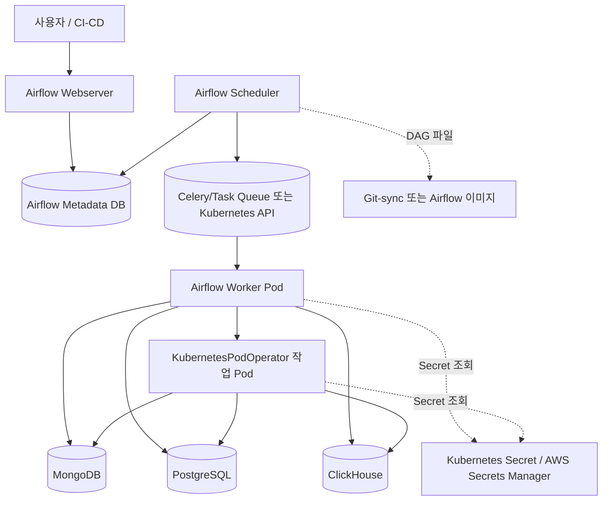

# MongoDB 연결 방식과 EKS Airflow 동작

## 1. 비교 대상

### MongoHook

```python
from airflow.providers.mongo.hooks.mongo import MongoHook

hook = MongoHook(mongo_conn_id="mongodb_default")
client = hook.get_conn()
collection = client["Statistics"]["UserDataHistoryDay"]
```

Airflow Provider가 제공하는 `MongoHook`은 Airflow Connection을 읽어 PyMongo 클라이언트를 생성한다. 접속정보는 Airflow UI, Secret Backend 또는 Kubernetes Secret 연동 방식으로 관리한다.

### 직접 연결

```python
from pymongo import MongoClient

client = MongoClient(
    host="mongodb.example.internal",
    port=27017,
    username="app_user",
    password="password",
)
```

직접 연결은 애플리케이션이 YAML, 환경변수 또는 별도의 Secret을 읽어 PyMongo/PostgreSQL 클라이언트를 직접 생성하는 방식이다.

## 2. 장단점

| 항목 | MongoHook | 직접 연결 |
|---|---|---|
| Airflow 통합 | 매우 좋음. `conn_id`로 일관되게 사용 | 직접 구현 필요 |
| Secret 관리 | Airflow Connection/Secret Backend 활용 | 환경변수·Kubernetes Secret 연동을 직접 구현 |
| 재사용성 | Airflow task 안에서 편리 | Airflow 외부 배치·로컬·테스트에서 편리 |
| 테스트 | Airflow 의존성이 필요 | 단위 테스트가 상대적으로 쉬움 |
| Provider 의존성 | `apache-airflow-providers-mongo` 필요 | `pymongo`만 있으면 됨 |
| 연결 옵션 | Airflow Connection Extra로 관리 | 코드·YAML에서 세밀하게 제어 가능 |
| 운영 표준화 | 팀 단위 표준화에 유리 | 프로젝트별 구현 차이가 생기기 쉬움 |
| Airflow 외부 실행 | 부적합하거나 별도 래퍼 필요 | 적합 |

## 3. 권장 결론

Airflow DAG task에서 MongoDB를 읽는 경우에는 `MongoHook`을 기본으로 사용한다.

```text
Airflow DAG
  → MongoHook(mongo_conn_id)
  → MongoDB 조회
```

다만 핵심 추출·변환 로직을 Airflow 밖에서도 실행해야 한다면, 비즈니스 로직과 연결 생성부를 분리한다.

```text
src/connections/
  └── MongoDB connection factory

src/extractors/
  └── MongoDB extraction logic

dags/
  └── MongoHook 또는 factory를 호출하는 얇은 orchestration 코드
```

같은 task에서 `MongoHook`과 직접 `MongoClient`를 동시에 만들지 않는다. 연결 풀과 인증 경로가 이중화되어 운영 문제가 생길 수 있다.

## 4. AWS EKS에서 Airflow 구성



## 5. 작업 실행 순서

```text
1. Scheduler가 DAG 파일을 주기적으로 파싱
2. 실행 시각이 되면 DAG Run 생성
3. Task Instance를 실행 큐에 등록
4. Worker 또는 KubernetesPodOperator가 작업 Pod 생성
5. 작업 Pod가 MongoHook/DB client로 원천 DB 접속
6. 추출·검증·변환·ClickHouse 적재 수행
7. task 상태와 로그를 Metadata DB/로그 저장소에 기록
8. Pod 종료 및 다음 task 실행
```

EKS에서 `KubernetesPodOperator`를 쓰면 Airflow Worker와 실제 데이터 처리 Pod가 분리된다.

```text
Airflow Worker
  └─ KubernetesPodOperator
       └─ data-processing image
            └─ MongoDB/PostgreSQL/ClickHouse 처리
```

이 경우 실제 처리에 필요한 `pymongo`, PostgreSQL driver, ClickHouse client, YAML 설정, 내부 `src` 패키지는 작업 이미지에 포함해야 한다. Airflow Scheduler가 DAG를 파싱하는 이미지에만 라이브러리를 설치하는 것으로는 충분하지 않다.

## 6. EKS 운영 시 필수 설정

### DAG와 코드 배포

- Scheduler와 Worker가 동일한 DAG 버전을 사용해야 한다.
- DAG는 Airflow 이미지에 포함하거나 Git-sync/Object Storage 방식 중 하나로 통일한다.
- 처리 로직은 작업 이미지에 포함하고 이미지 태그를 버전으로 고정한다.

### Secret

- MongoDB/PostgreSQL 비밀번호를 DAG 소스나 YAML에 평문 저장하지 않는다.
- Airflow Connection 또는 AWS Secrets Manager/Kubernetes Secret을 사용한다.
- `conn_id`와 Secret key 이름만 코드에 둔다.

### 네트워크

- EKS Pod에서 MongoDB, PostgreSQL, ClickHouse로 라우팅되어야 한다.
- VPC, Security Group, NetworkPolicy, DNS, TLS 인증서를 확인해야 한다.
- 사설 DB라면 Pod가 위치한 Subnet과 라우팅 테이블을 확인해야 한다.

## 7. 이 프로젝트에 대한 추천

```text
dags/
  └── 고객사 DAG와 task 의존성만 정의

src/connections/
  └── Airflow 외부에서도 사용할 수 있는 connection factory

src/extractors/
  └── MongoDB/PostgreSQL/Athena 추출 로직

작업 이미지
  └── pymongo, PostgreSQL driver, ClickHouse client, 내부 패키지 포함
```

Airflow task 안에서만 실행되는 단순 조회는 `MongoHook`을 사용하고, 로컬 실행·통합 테스트·Airflow 외부 배치에서도 재사용할 핵심 모듈은 직접 connection factory를 사용하도록 경계를 정하는 것이 적절하다.

공식 참고:

- [Airflow MongoHook](https://airflow.apache.org/docs/apache-airflow-providers-mongo/stable/_api/airflow/providers/mongo/hooks/mongo/index.html)
- [Airflow MongoDB Provider](https://airflow.apache.org/docs/apache-airflow-providers-mongo/stable/index.html)
